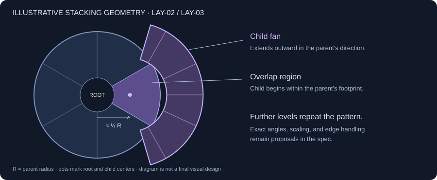

# Constellation — product & behavior spec

**Draft 0.1 · 2026-10-23 · Native preview available for review**

A lightweight, globally invoked Windows system-tray radial launcher: invoke a shortcut while using another app, navigate nested **Constellations**, and launch a **Star**. The resident app should use as little memory and processing time as practical; configuration may live in a separate process.

**Status key:** **Agreed** = explicit product decisions from our discussion. **Proposed** = suggested details requiring review. **Unresolved** = an open choice. “Must” applies within the stated status; proposals are not approved requirements.

**Review route:** [settings](#2-shortcut-settings) → [interaction](#3-interaction) → [layout](#4-radial-layout) → [resource targets](#6-resource-use--implementation-direction).

## 1. Scope & vocabulary

**Agreed** unless marked otherwise.

| ID | Concept | Meaning / requirement |
|---|---|---|
| CORE-01 | Star | A selectable launch target, such as a program or shortcut. Selecting it requests a launch. |
| CORE-02 | Constellation | A virtual folder containing Stars, other Constellations, or both. Opening it reveals children; it does not launch them. |
| CORE-03 | Shortcut profile | A configurable keyboard or mouse binding with its own activation and Constellation-opening behavior. |
| CORE-04 | Nested navigation | Users must be able to navigate multiple Constellation levels without dismissing the launcher. |
| CORE-05 | Configuration | Users must be able to add Stars and Constellations and configure shortcut profiles. |
| CORE-06 | Resident launcher | The process that waits for bindings and displays the radial. Lightweight operation is a primary constraint; see PERF-01. |
| CORE-07 | Tray application | Run in the Windows notification area without a persistent main window. Closing the radial or configuration panel leaves the resident launcher running; explicit Quit exits it. |
| CORE-08 | Global invocation | Listen for configured bindings across foreground apps on the user's desktop. Neither the configuration panel nor another Constellation window needs focus. Fullscreen apps are excluded under FS-01–02. |

**Agreed distribution:** a self-contained portable folder; see §5.1. Windows is the first implementation, with boundaries that support a later Linux port (ARCH-03).

**Proposed first release:** one shared item tree. Shipping a Linux build, cloud sync, plugins, and automated application discovery are outside this draft's scope. The native renderer and configuration UI remain implementation choices.

## 2. Shortcut settings

Each row is authoritative for its setting. Bindings are invocations; Star targets are the things launched.

| ID | Setting | Choices | Default | Status |
|---|---|---|---|---|
| CFG-01 | Binding | Keyboard combination or supported mouse button | Ctrl+Q | Agreed |
| CFG-02 | Activation | Click: press to open / Hold: release to select | Click | Agreed |
| CFG-03 | Open Constellations | Hover / Left click | Hover | Agreed |
| CFG-04 | Opening position | Always centered, with cursor moved to center | Centered | Agreed; fixed for the first release |
| CFG-05 | Cursor on close | Restore original / Return to menu center / Leave at selection | Restore original | Restore and center agreed; leave retained as a compatibility option |
| CFG-06 | Hover timing | No intentional opening or ancestor-collapse delay | 0 ms | Agreed |
| CFG-07 | Cursor appearance | White dot / system cursor, per shortcut profile | White dot (initial implementation default) | Agreed optional custom pointer; white-dot design selected |
| CFG-08 | Outside targeting | Exact painted sectors / Extend direction beyond outer edge | Extend direction | Requested behavior; initial default proposed |

**Agreed:** CFG-01–03, CFG-05, and CFG-08 apply independently to each shortcut profile. CFG-04 and CFG-06 are shared requirements, not per-profile choices. Hold mode must support an appropriate mouse binding as well as keyboard input.

| ID | Centered opening rule | Status |
|---|---|---|
| CUR-01 | On invocation, select the monitor containing the pointer before moving it, save the original cursor position once, and center the cursor and root radial within that monitor's usable work area excluding the taskbar before enabling selection. | Agreed |
| CUR-02 | Keep a visible navigation pointer while open. Use the profile's CFG-07 appearance over the invocation work area; the white dot has a centered selection hotspot and a subtle dark outline. On launch or dismissal, apply CFG-05 once. Return to center uses the invocation monitor's saved work-area center. Restore the normal cursor when closing; FS-02 forbids moving it during fullscreen takeover. | Agreed |
| CUR-03 | All shortcut profiles use centered opening. Move the cursor to the root center on invocation, not on each child expansion; navigation leaves the cursor under user control. | Agreed |
| CUR-04 | For a successful launch, close the overlay and apply CFG-05 before handing the launch request to the target. If cursor movement fails, cancel centered invocation and report it. | Proposed |

Restoration happens after use, rather than immediately after opening. Recovery from display/cursor/input interruptions is defined in END-05; fullscreen non-interference is defined in FS-01–02.

## 3. Interaction

“Hovered Star” means the pointer targets a visible Star, including its extended angular region under CFG-08. A highlighted Constellation is not a Star. Folder-opening rules apply at every depth.

### 3.1 Open, navigate, select

**Agreed** unless marked otherwise.

| ID | State / event | Condition | Result |
|---|---|---|---|
| INT-01 | Closed → binding activated | Any profile; FS-01 permits invocation | Open a fresh root using that profile's settings and CUR rules. Never expose pixels or queued pointer coordinates from the previous gesture during opening. |
| INT-02 | Open → pointer enters Constellation | CFG-03 = Hover | Reveal its children in that sector's radial direction with no intentional delay (CFG-06). |
| INT-03 | Open → left click Constellation | CFG-03 = Left click | Reveal its children; do not launch anything. |
| INT-04 | Click mode → left click Star | Pointer is over a Star | Select that Star and request its launch. |
| INT-05 | Click mode → Space pressed | Pointer is over a Star | Same outcome as INT-04. |
| INT-06 | Click mode → invoking binding released | No selection | Remain open. |
| INT-07 | Hold mode → any required key or invoking mouse button released | Pointer is over a Star | Select that Star and request its launch. For a multi-key binding, releasing any required key ends Hold; unrelated key releases do not. |
| INT-08 | Hold mode → invoking binding released | Over a Constellation, hub, or empty space | Proposed: close without launching. |
| INT-09 | Hold mode → left click or Space | Pointer is over a Star | Proposed: allow explicit selection, close, and consume the later release without launching again. |

**Agreed usage expectation:** Hold mode will primarily use a single-key or mouse-button binding; multi-key combinations remain supported. INT-07 applies to all of them.

### 3.2 Navigation continuity & dismissal

These are **Proposed unless marked Agreed**, based on the prototype and subsequent decisions.

| ID | Event | Result |
|---|---|---|
| NAV-01 | Enter another Constellation at an existing level | Replace that level's active branch and its descendants; preserve ancestors. |
| NAV-02 | Cross a gap while approaching a child | Preserve the open branch; never close it solely because the pointer left its parent sector. |
| NAV-03 | Hover an ancestor-level Star | **Agreed:** collapse deeper descendants with no intentional delay (CFG-06); retain the Star as the candidate. |
| NAV-04 | Backspace / click center hub | Backspace closes the deepest child fan; hub returns to root. Neither launches a Star. |
| NAV-05 | Enter an empty Constellation | Show an empty state with a route back; do not launch or dismiss. |
| END-01 | Escape / unassigned right click / left click in an untargeted region | Close without launch and apply CUR-02. A mouse button bound to invocation takes precedence over dismissal. |
| END-02 | Invoke the same Click profile again | Toggle closed. Ignore key-repeat events so holding a Click binding cannot repeatedly toggle. |
| END-03 | Foreground application changes or session interrupted | Cancel selection, close, and apply restoration where possible. Never launch from a late release event. The Windows overlay keeps the invocation’s foreground app active and receives radial commands through its input worker. |
| END-04 | Invoke another profile while open | **Agreed:** ignore that invocation. Keep the active profile, navigation path, and saved cursor restoration position unchanged. Only the active Hold profile's release can complete its selection. |
| END-05 | Display changes, cursor-control failure, or input capture prevents a usable interaction | **Agreed:** cancel cleanly without launching; close the overlay, restore the cursor where possible, and invalidate pending selection/release events. FS-02 takes precedence if a fullscreen app becomes active. |

**Proposed lifecycle summary** — requirement tables above are authoritative:

```mermaid
stateDiagram-v2
    [*] --> Closed
    Closed --> Open: Invoke profile
    Open --> Open: Navigate Constellations
    Open --> Finish: Select Star
    Open --> Finish: Dismiss or cancel
    Finish --> Closed: Close overlay; apply restoration
```

“Finish” denotes a transition sequence, not another persistent screen. Only the selection path dispatches a launch.

### 3.3 Fullscreen non-interference

**Agreed first-release policy:** Constellation must stay out of fullscreen applications' way; overlaying them is not a compatibility goal.

| ID | Condition | Behavior |
|---|---|---|
| FS-01 | A fullscreen app is in the foreground | Ignore launcher invocation without opening an overlay, moving the cursor, taking focus, or queuing a launch for later. Leave the input available to that app; the normal input-consumption rule BIND-03 does not apply while invocation is suspended. |
| FS-02 | A fullscreen app becomes foreground during a radial interaction | Cancel without launching, hide the radial, and discard pending selection/release events. Do not reclaim focus or force cursor restoration into the fullscreen app. Resume normal availability after leaving it. |

**Proposed detection scope:** include exclusive and borderless fullscreen; ordinary maximized windows remain eligible. Verify detection and input pass-through in the native implementation rather than assuming an ignored registered hotkey automatically reaches the other app.

### 3.4 Constellation lights & chimes

**Requested feature; proposed behavior details below.** Here, “highlight” means the current hovered/focused item; it does not select a Star for launch. Existing activation rules remain authoritative.

| ID | Feedback | Behavior | Status |
|---|---|---|---|
| FX-01 | Bright node | Show a small bright dot on the currently highlighted Star or Constellation. Keep ancestor Constellation dots illuminated along the active branch. | Proposed |
| FX-02 | Constellation lines | Connect an active parent Constellation's dot to its highlighted child, repeating along the active nested path. Replace the affected connection when switching siblings; never connect unrelated siblings as though they were parent/child. | Proposed |
| FX-03 | Chime | Play a short bell-like chime on transition to a different highlighted Star or Constellation. Choose a random note from one pentatonic scale; staying on the same item or redrawing it does not retrigger audio. | Proposed |
| FX-04 | Sound controls | Provide mute and volume controls. Exact default volume, notes, timbre, and decay are tunable during prototyping. | Proposed |
| FX-05 | Fast navigation | New notes overlap existing notes and let their tails finish. Feedback must not block selection or add dwell time. Initial implementation: bounded 32-voice mix with soft limiting; when saturated, omit a new note instead of cutting an existing one. | Agreed behavior; implementation limit proposed |

Prefer a small preloaded sound set or compact procedural bell generation; choose the audio implementation after checking idle cost. A per-item stable pitch can be considered later if random notes make feedback less recognizable. Feedback is app-managed, including any audio assets, under PORT-02.

## 4. Radial layout

**CFG-08 targeting:** painted sectors take precedence. Outside all painted sectors, extend their existing angles beyond each fan's outer radius; prefer the deepest visible fan. Keep angular gaps and the root hub neutral. Do not change saved geometry or dispatch before the normal selection event. Exact targeting keeps the outer edge as a boundary.

**Illustrative geometry:** the drawing explains LAY-02 and LAY-03. Its counts and dimensions are not final requirements.

| ID | Rule | Status |
|---|---|---|
| LAY-01 | Sectors must subdivide as items are added; every Star and Constellation receives a selectable sector. User-chosen layouts may compromise visibility or reachability; handle that through LAY-12–14 rather than automatic correction. | Agreed |
| LAY-02 | A child fan must grow in its parent sector's radial direction and overlap the parent instead of adding a wholly separate ring. | Agreed |
| LAY-03 | The default child fan starts around halfway along the parent radial and extends beyond its outer boundary; repeat the stacking pattern at deeper levels. User spacing settings may override the default distance and spread. | Agreed intent; exact defaults proposed below |
| LAY-04 | Preserve user-selected geometry even if partly off-screen or crowded. Show the advisory warning under LAY-12; do not force a fit, redistribute items, or block use of the layout. | Agreed |
| LAY-05 | Use stable configured item order; adding items subdivides sectors rather than automatically reordering existing items by usage. | Proposed |
| LAY-06 | Keep a neutral center region that cannot launch anything. Distinguish Stars from Constellations visually. | Proposed |
| LAY-07 | Support fast, repeatable mouse gestures for launching: selection must follow the current pointer position without an intentional dwell period or a transition animation that blocks input. | Agreed interaction goal |
| LAY-08 | Place the root once per invocation using CUR-01. Opening children must not translate or rescale already visible sectors or the root beneath the pointer. | Agreed |
| LAY-09 | Use the saved geometry exactly during invocation and navigation. Do not automatically shift, rotate, resize, or rescale the root or a child fan to fit an edge. Users tune the layout with LAY-10–11. | Agreed |
| LAY-10 | Provide controls for radial size, distance between parent/child centers, child fan spread, and gaps between sectors. Slider ranges/defaults may be tuned during prototyping; do not impose usability-based restrictions under LAY-14. | Agreed |
| LAY-11 | Provide a non-launching Visualize mode in configuration that shows the full nested fan-out, including branches that are not normally open together, against the selected monitor's usable work-area bounds. Spacing edits must update this preview using the launcher's layout rules. | Agreed capability |
| LAY-12 | Flag geometry extending outside the selected work area and excessively narrow targets with a small, subdued inline warning in configuration/Visualize mode. Allow saving and use without a modal, forced correction, or attention-grabbing notification. Partial overflow may be intentional and usable. | Agreed |
| LAY-13 | Continue subdividing a fan as its item count grows. Do not introduce Previous/More pages, replace the visible stack, or impose an item-count cap to maintain target size. | Agreed |
| LAY-14 | Keep usability checks advisory: users may save crowded, overlapping, narrow, or overflowing layouts. A minimum readable/selectable-size threshold may drive a warning, never a save/use restriction. Ordinary data validity and storage errors remain subject to DATA-03 and PORT-04. | Agreed |

**Proposed control detail:** broad slider ranges plus direct numeric entry for values beyond the convenient slider range. Determine warning thresholds during prototyping; they are advisory, not enforced layout limits.

**Proposed preview detail:** additionally indicate overlapping targets; label any preview zoom so a scaled-down overview cannot be mistaken for a layout that fits at actual size. Previewing must not move the system cursor or dispatch launch requests. Saving spacing changes applies to the next invocation, keeping an active gesture stable.

**Prototype candidates, not commitments:** base radius 144 px; child-center offset 52% of that radius; child fan span about 148°; child inner/outer radii 58%/115% of the base radius. The current browser prototype translates/scales the whole stack; that behavior does not satisfy LAY-08 and must not carry into the native implementation.

The prototype switches to Previous/More sectors above its capacity thresholds; this paging does not satisfy LAY-13 and must not carry into the native implementation. Do not treat the prototype's pixel values as physical sizes across monitors.

## 5. Configuration & launch handling

**Proposed** details supporting CORE-01 through CORE-05.

| ID | Capability | Rule |
|---|---|---|
| DATA-01 | Item editing | Create, rename, move, reorder, and remove items. Moving a Constellation must not allow it to become its own descendant. |
| DATA-02 | Persistence | Save item hierarchy, order, launch definitions, and profile settings within the portable folder (§5.1); reload them on restart. Stable item/profile IDs survive renames. |
| DATA-03 | Valid configuration | Reject invalid edits with a useful message; retain the last valid configuration if a new file cannot be loaded. |
| DATA-04 | Launch definition | **Agreed target types:** programs, Windows shortcuts, URLs, filesystem folders, and scripts. **Proposed configuration:** separate display name from target; support arguments and working directory, with an interpreter/runner for script targets. |
| BIND-01 | Binding conflict | Report registration failure and keep other profiles usable. Do not silently replace a failed combination with another shortcut. |
| BIND-02 | Duplicate profile binding | Reject ambiguous duplicate bindings within this app. Registration success does not prove a shortcut is unused by other apps. |
| BIND-03 | Consume invocation | **Agreed:** when invocation is enabled, consume a recognized global launcher binding so the foreground app does not also execute it. Handle associated repeats and releases consistently; pass unrelated input normally and keep modifier state balanced. This includes invocations ignored under END-04, but excludes fullscreen suspension under FS-01. |
| BIND-04 | Consume selection | **Agreed:** inputs used to select a Star or navigate/dismiss the open radial must not also activate the underlying app. Hold completion must not leak a second launch or an unmatched release. |
| RUN-01 | Launch dispatch | Dispatch at most once per selection, including repeated input and later Hold release. Never dispatch a Constellation. |
| RUN-02 | Missing or failed target | Report the failure without an automatic retry or elevated relaunch. Preserve configuration so the target can be fixed. |
| DATA-05 | Editor separation | The configuration panel may run in a separate process. Closing it must leave shortcuts and launching usable. |
| DATA-06 | Target selection | **Agreed capability:** provide file/folder pickers and drag-and-drop for creating Stars. **Initial implementation:** infer names/types; store in-folder paths relatively and external paths explicitly. |
| DATA-07 | Friendly argument editing | **Agreed capability:** ordinary argument entry and clear validation. **Initial implementation:** double-quoted argument text maps to a string vector; unfinished quotes retain the edit and show an inline error. No shell expansion is implied. |
| DATA-08 | Draft safety | **Agreed capability:** undo/redo and protection of unsaved edits when switching items. **Initial implementation:** apply valid fields before switching, retain invalid fields, and keep bounded session-only snapshot history. Save remains the persistence step. |
| DATA-09 | Configuration transfer | **Agreed capability:** import/export. **Initial implementation:** validate before replacing the draft; imports are undoable and require Save. Exports contain configuration, not bundled targets/assets. Explicitly chosen export documents may be written to the user's selected destination; no background storage fallback is introduced. |
| DATA-10 | Target advice | **Agreed capability:** warn about missing targets without preventing configuration. Availability can change after editing; dispatch errors remain governed by RUN-02. |

**Editor presentation — agreed goals; initial native styling:**

| ID | Requirement |
|---|---|
| LOOK-01 | **Agreed:** smooth radial curves/diagonals and symbols with antialiasing and transparent edges. Preserve selection geometry. |
| LOOK-02 | **Agreed:** subtle soft outlines, darker and slightly shifted toward blue; tiny semitransparent white star specks with slightly varied sizes. **Initial implementation:** static, deterministic decoration kept away from names/icons; no continuous animation. |
| LOOK-03 | **Agreed:** a single four-point Star represents the app/tray and individual Stars; a group of three smaller stars represents Constellations in the radial and its preview. Configuration lists use one hollow star for Constellations. **Initial implementation:** mint app/Star symbol, lavender Constellation cluster; transparent multi-resolution Windows icon embedded in the executable. |
| LOOK-04 | **Agreed capability:** automatic target icons and per-item custom icons. **Initial implementation:** Automatic / Symbol / Custom image / From Software modes. From Software uses a separately chosen executable/shortcut icon without changing the launch target; reference the source in place, using a relative path inside the portable folder. Windows resolves executable/shortcut/file-association icons asynchronously; missing/unreadable sources use the existing Star/Constellation symbol. Custom PNG/JPEG/BMP/ICO files are copied into portable `data/icons` and referenced relatively. Decode/resize off the UI/input thread; bound the decoded cache. |
| UI-01 | Configuration should visually belong to Constellation. Initial styling uses the radial palette, readable Segoe UI text, grouped panels and clear primary actions. User-selectable themes remain future work. |
| UI-02 | Scrolling must not visibly erase/flash the whole form, duplicate/overlap controls, or move panel outlines differently from their contents. Use one coordinate system for painted content and native controls; reuse an unchanged preview. Edit and monitor/viewport changes invalidate the relevant cache. |
| UI-03 | Resizing/maximizing expands the item list, editor column and preview into available space. Show each scrollbar only when content exceeds that axis; account for the other scrollbar’s space and clamp stale scroll offsets after resizing. |

### 5.1 Portable folder

**Agreed** unless marked Proposed. This contract applies to the resident launcher, configuration UI, and app-managed helper processes on each supported platform.

| ID | Rule |
|---|---|
| PORT-01 | Distribute an extract-and-run folder, without an installer or installation step. Users choose its location; the app must not install itself into Program Files or another system directory. |
| PORT-02 | Keep all app-managed persistent and temporary files inside that folder: configuration, backups, icons, logs, caches, and any update staging. Do not use AppData, the user's home/config/cache directories, system temp directories, or registry settings as alternate storage. OS-managed records and data written by launched target programs are outside this app-storage contract. |
| PORT-03 | Resolve the portable root from the application's executable location, not the process working directory. The launcher and any separate configuration UI must share that root. |
| PORT-04 | If required local storage cannot be written, show a clear error and preserve existing data; never silently fall back to an external storage directory or request elevation to create one. |
| PORT-05 | Moving or copying the whole folder while the app is stopped must retain its configuration and app-managed assets. No app-owned settings may depend on the old absolute root. References to separately installed programs remain external targets. |
| PORT-06 | **Proposed:** support executable-root-relative target and asset paths for bundled scripts/tools; preserve explicitly absolute paths to external programs. Do not resolve relative targets against the caller's working directory. |

No installer, automatic system registration, or startup registration is part of the portable baseline. Runtime tray and global input registration remain necessary for CORE-07–08.

## 6. Resource use & implementation direction

| ID | Requirement / direction | Status |
|---|---|---|
| PERF-01 | Minimize resident RAM, CPU use, and background work; an idle launcher should do no unnecessary rendering or processing. | Agreed priority |
| PERF-02 | Process eligible hover navigation without intentional timers or debounce delays. A 0 ms configured delay means no added wait, not literally zero input-to-display latency. | Agreed |
| PERF-03 | Treat roughly 50–200 MB of idle resident RAM as an acceptable initial planning range, with about 200 MB as a soft upper target. Lower usage is welcome; 50 MB is not a minimum. This is not a measured result or hard release gate. | Agreed rough target |
| PERF-04 | Do not block initial implementation on further CPU/latency budgets or intensive memory tuning. Check basic idle use and interaction responsiveness; revisit resource targets if real measurements reveal a problem. | Agreed priority |
| ARCH-01 | Prefer a Rust resident process using native Windows input and drawing; keep a browser runtime out of that process. | Proposed; implemented in the native preview, with a recorded idle sample |
| ARCH-02 | Use native global hotkey registration for supported keyboard invocations; evaluate lightweight keyboard/mouse hooks where release tracking or suppression requires them. Keep hook callbacks short and perform layout/launch work outside them. | Proposed; BIND-03–04 require native verification |
| ARCH-03 | Keep hierarchy, configuration model, radial geometry, hit testing, and interaction state portable. Isolate tray, overlay/window integration, global input, cursor/monitor control, and target execution behind platform adapters. Detect desktop capabilities rather than assuming Windows behavior is universally available. | Agreed portability direction; Linux capability fallbacks need review before its port |

The initial RAM reference is the user's approximate recollection of KROW's tray usage, not an independently verified KROW benchmark.

**Proposed lightweight check:** in a release build, record working set and private bytes after 60 seconds idle in the tray, with the radial and editor closed. Include app-managed resident helper processes; exclude launched target programs. Report editor-open usage separately and note the machine, item count, and display scaling. Detailed benchmarking is optional unless a problem warrants it.

| Metric | Measurement | Target |
|---|---|---|
| Resident memory | Idle working set, with private bytes reported for context | PERF-03; metric choice proposed |
| Idle CPU | Observe process CPU time while radial/editor are closed | No unnecessary background work; no numerical gate |
| Opening latency | Binding event → first usable radial frame | Responsive interaction; no numerical gate |
| Navigation latency | Eligible hover/click → usable child fan | PERF-02; no intentional delay or numerical gate |

Browser prototype resource use is not evidence of native launcher performance. A native idle sample and automated interaction checks are recorded in [verification](VERIFICATION.md); perceived responsiveness still requires hands-on review.

## 7. Acceptance checks

These describe acceptance criteria; the [verification record](VERIFICATION.md) states actual native coverage and remaining checks. Checks involving proposals become release criteria only when those proposals are agreed.

| Check | Covers | Observable pass condition |
|---|---|---|
| A-01 | CFG-01–06, INT-01–09 | Two profiles retain different settings. Click survives binding release; Hold completes on release of its single bound input or any required key in a combination, ignores unrelated releases, and selects only the eligible hovered Star. |
| A-02 | CORE-04, CFG-06, LAY-02–03, LAY-07, NAV-01–05 | Traverse at least three nested Constellations with fast mouse gestures, cross gaps, return, and switch branches without an unintended launch or deliberate dwell. Hover opening and ancestor-Star collapse add no intentional wait; empty branches remain escapable. |
| A-03 | CUR-01–04, CFG-04–05, CFG-07 | Invoke each profile from an off-center position on each monitor; both cursor and root open at the pointer monitor's work-area center excluding the taskbar. Test all three cursor-end choices after launch/cancellation; no recentering during child navigation. |
| A-04 | END-01–05, RUN-01 | Repeat, cancel, interrupt focus, and release after explicit selection. No duplicate or late launch occurs. Invoke another profile while open: the active profile, navigation path, and saved restoration position remain unchanged. Interrupt via display/cursor/input failure: cancel without dispatching a launch. |
| A-05 | LAY-01, LAY-04–06, LAY-08–09, LAY-13–14 | Add many items and verify continued subdivision without paging or an item-count cap for target size. Across deep branches, display edges, and DPI settings, preserve saved geometry. User-chosen visibility/reachability compromises produce advisory warnings rather than forced corrections. |
| A-06 | DATA-01–05 | Edit, restart, and verify persistence; reject a cyclic move and malformed configuration without losing valid data. |
| A-07 | BIND-01–02, RUN-02 | A failed binding leaves other profiles working; a missing target produces a useful error and no retry loop. |
| A-08 | PERF-01–04 | Check idle RAM against the rough planning target and observe CPU/responsiveness under §6 conditions. Record evidence without treating a soft target as a hard release gate; distinguish actual processing/rendering latency from intentional delay. |
| A-09 | DATA-04 | Configure and successfully launch one of each agreed target type, including a script, without treating virtual Constellations as filesystem folders. |
| A-10 | CORE-07–08, BIND-03–04 | With the editor closed and another app focused, invoke the default profile and verify the radial opens without that app executing its binding. Test ignored profiles, repeats, Hold releases, selection click/Space, cancellation, and subsequent typing for leaked input or stuck modifiers. Closing the UI keeps tray invocation available; explicit Quit stops it. |
| A-11 | PORT-01–06, DATA-02 | Extract to a user-selected folder, run from a different working directory, edit settings, and inspect app-managed writes for confinement to the portable root. Stop, move the whole folder, and verify settings/assets survive. With writes denied, report the error without external fallback. If PORT-06 is adopted, verify a bundled relative script still launches after moving. |
| A-12 | LAY-10–12, LAY-14 | Open Visualize mode with sibling and nested Constellations; verify all four spacing controls update the full fan-out preview. Deliberately overflow the work area and create narrow targets: a subdued inline warning appears, saving remains available, and no auto-fit or blocking prompt occurs. Preview must not dispatch a target launch. |
| A-13 | FS-01–02, BIND-03 | With a fullscreen app foreground, invoke a configured binding and verify no overlay, cursor movement, focus takeover, delayed launch, or input suppression. After leaving fullscreen, invocation works normally. Enter fullscreen while the radial is open: it cancels without launch or cursor/focus takeover. |
| A-14 | FX-01–05 | Hover through nested Constellations and sibling Stars: dots and lines follow the active parent/child path, with one chime per highlight transition and none on stationary redraws. Verify mute/volume, overlapping notes with uninterrupted tails, bounded saturation, and selection with no feedback-induced delay. |
| A-15 | DATA-06–10 | Pick target/runner/folder paths; drop multiple kinds; preserve quoted and empty arguments. Switch with valid and invalid edits. Undo/redo changes after Save, delete a branch, and import valid/malformed files without losing the previous valid draft. Export a readable snapshot without silently bundling programs. |
| A-16 | INT-01, CFG-08 | Reopen after selecting from an expanded branch: a fresh root is presented before becoming visible; stale window mouse messages cannot expand it. Test far-away Star/child directions, gaps, hub, click/Hold selection, and exact-targeting opt-out. |

## 8. Evidence & prototype boundary

A first Windows native preview now implements the main interaction, tray, configuration, and feedback features. See the [user guide](USER-GUIDE.md) for controls/limits and [verification record](VERIFICATION.md) for measured evidence and checks still requiring hands-on review. Proposed details implemented as initial defaults remain subject to product review.

The product decisions in this draft come from this chat. The [shortcut research](shortcut-research.md) records documented conflicts. The [prototype notes](../prototype/README.md), [interaction implementation](../prototype/app.js), and [geometry](../prototype/geometry.mjs) document experiments; copied values are explicitly proposed above.

The browser demonstrates overlapping navigation, selection modes, density paging, and centered menu opening. It simulates launches, receives input only while focused, and cannot center or restore the system cursor. Passing its checks does not validate native hotkeys, launching, cursor control, or performance.

Customization research is kept separately in [PERSONALIZATION-STUDY.md](PERSONALIZATION-STUDY.md). Its proposed themes, icons/images, and compatible-program actions are not committed release requirements or implemented controls.
